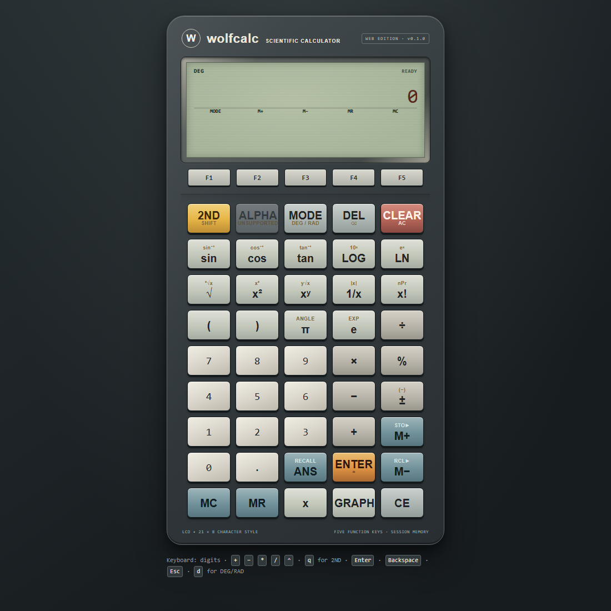

# wolfcalc

[**Open the live calculator →**](https://chriseatontx.github.io/wolfcalc/)



wolfcalc is a browser-based scientific calculator with an original interface informed by vintage graphing calculators. It uses plain HTML, CSS, and JavaScript and has no external runtime dependencies.

## Run locally

Use Node.js 24 or newer. From the repository root:

```powershell
npm start
```

Open the local address printed by the server (by default, `http://127.0.0.1:8000/`). Stop the server with Ctrl+C.

To run the calculator and local-server tests:

```powershell
npm test
```

The full repository test suite is also available with `npm run test:all`.

## Versioning and releases

`package.json` is the source of truth for the calculator version. The version is shown in the calculator's header and included in the GitHub Pages deployment. For an intentional patch release, run:

```powershell
npm run version:patch
```

Review the updated `package.json`, commit it with the shipped change, and use a matching `v`-prefixed tag when publishing a GitHub release. CI requires every change to the shipped calculator files (`index.html`, `styles.css`, or `js/`) to increase the valid semantic version compared with its base revision. Documentation, tests, and development-only files do not require a version bump.

## Features

- Arithmetic with precedence, parentheses, unary signs, and chained expressions
- Scientific functions, constants, factorial, percentages, and degree/radian modes
- One-slot calculator memory and previous-answer recall
- A single-function Cartesian graph over a fixed viewing window
- Mouse and keyboard input, responsive layout, and clear unsupported-key labeling

Statistics, programmable menus, and ALPHA character entry are not implemented. The visual design and product identity are original; the interface does not use another calculator's product name or marks.

## Project structure

- `index.html`, `styles.css`: page and calculator presentation
- `js/core/`: calculator state, expression evaluation, and graph sampling
- `js/ui.js`: browser interaction and display rendering
- `tests/`: Node.js built-in test suite

The project uses only Node.js built-in modules and browser APIs.

## License

This project is available under the MIT License. See `LICENSE` for the terms.

## GitHub Pages

The live demo is hosted on GitHub Pages. The manual deployment workflow in `.github/workflows/pages.yml` publishes only the calculator page assets.

